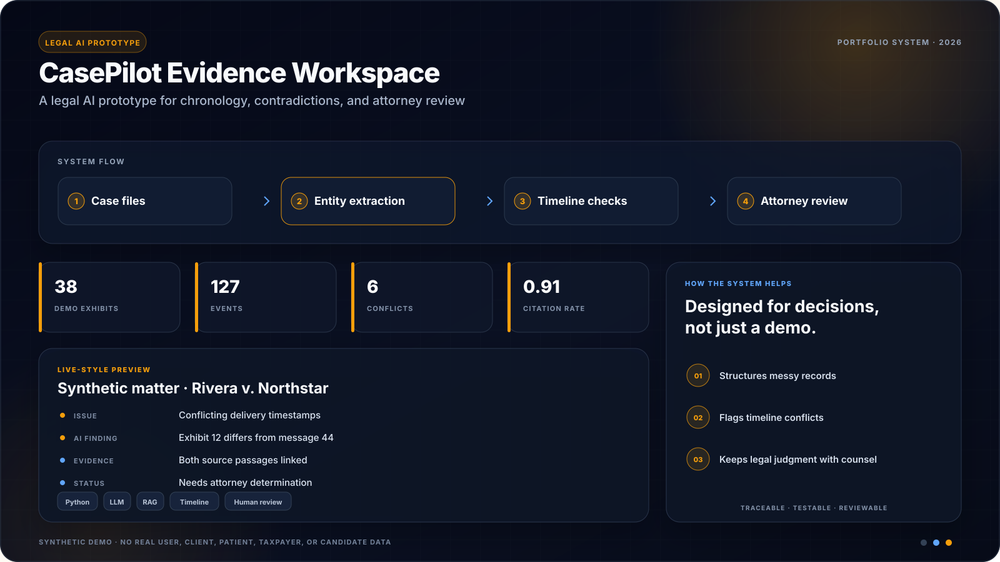

# CasePilot: Plaintiff Case Intelligence Prototype


<!-- portfolio-showcase:start -->
<p align="center">
  
</p>
<p align="center"><sub><strong>Portfolio preview:</strong> all names, records, metrics, and scenarios shown above are synthetic. No real user or customer data is included.</sub></p>
<!-- portfolio-showcase:end -->

[](https://github.com/akhil15123/case-pilot-legal-ai-prototype/actions/workflows/ci.yml)

A full-stack prototype for explainable, plaintiff-side legal document intelligence workflows.

## Overview

CasePilot is a full-stack legal document intelligence demo designed for personal injury and truck wreck matters. It ingests litigation files and medical records, builds a chronology, surfaces case risks, identifies missing support, and generates plaintiff-side work product with citations.

This prototype is intentionally narrow and practical:

- Plaintiff-side case intake and record review
- Multiple sample plaintiff matters to show reusable product behavior
- Medical chronology generation
- Treatment-gap and contradiction detection
- Evidence coverage scoring across liability, causation, damages, and future care
- Provider journey and damages modeling
- Demand-letter drafting with grounded citations
- Downloadable case memo export
- Conversational case Q&A over uploaded records

## Product goals

The prototype targets recurring problems in plaintiff-side case preparation:

- reducing time spent reviewing records
- improving consistency in case preparation
- surfacing missing evidence before demand or mediation
- drafting usable work product faster

## Features

- Matter switcher with two sample plaintiff-side cases
- Executive strategy memo with plaintiff themes and defense themes
- Evidence coverage matrix with strength scoring
- Case overview with damages, document counts, and next actions
- Citation-grounded medical and litigation timeline
- Automatic issue spotting:
  - treatment gaps
  - contradictory medical history
  - missing wage-loss support
  - recommended but absent follow-up care
- Damages model:
  - current specials
  - projected future-care reserve
  - wage-loss support when present
- Provider journey showing who added what to the file
- Draft generation:
  - demand letter summary
  - deposition outline for liability
- Simple legal-document Q&A with source citations
- Searchable document library
- Downloadable markdown case report

## Stack

- Backend: Node.js HTTP server
- Frontend: HTML, CSS, vanilla JavaScript
- Data layer: local JSON case bundle
- AI workflow style: deterministic retrieval, chronology extraction, issue spotting, and template generation

The structure is deliberately lightweight so the project is easy to run and review. The engine is also cleanly separable for swapping in a hosted LLM or embedding layer later.

## Run locally

```bash
git clone https://github.com/akhil15123/case-pilot-legal-ai-prototype.git
cd case-pilot-legal-ai-prototype
npm run check
npm run smoke
npm run start
```

Then open [http://localhost:4173](http://localhost:4173).

## Preview


## Repo structure

```text
anytime-ai-case-agent/
├── data/cases/truck-wreck-demo/
│   ├── case.json
│   └── documents.json
├── docs/
│   └── project-summary.md
├── public/
│   ├── app.js
│   ├── index.html
│   └── styles.css
├── src/
│   ├── lib/case-engine.mjs
│   ├── server.mjs
│   └── smoke-test.mjs
└── README.md
```

## What the demo shows

The included sample matters are:

- a truck wreck case with treatment-gap and wage-support issues
- a premises liability slip-and-fall case with wage verification and MRI-backed knee injury

The system turns those files into:

- a treatment chronology
- an issue list with litigation implications
- an executive strategy memo
- an evidence coverage view
- a damages model with future-care reserve
- a demand draft summary
- suggested next actions for the legal team

## Notes

- This is a demo project with sample case data.
- The included workflow is intentionally explainable and auditable.
- The architecture is designed so an LLM provider, OCR pipeline, and vector store can be added without changing the frontend contract.
